# Patient-Level Differential Privacy in Hierarchical Federated Learning for Multimodal Medical IoT

**Framework name:** PP-HFM (Patient-Private Hierarchical Federated Multimodal learning)
**Authors:** Samartha H V, Shreyas J, Gururaj H L, Udayaprasad P K, Shreelakshmi Yadav N, Sowmya T Rao
**Institution:** Manipal Institute of Technology Bengaluru, MAHE
**Source of every number:** the final manuscript `PLDP/` (research frozen 4 Nov 2026)

These notes explain the whole study in order. Read them once from start to finish before
presenting. Each section opens with a short summary (**In one line**) that you can say out loud.

---

## 1. The Research in One Paragraph

Hospitals and medical IoT devices hold multimodal patient data that cannot be pooled in one place.
Federated learning (FL) trains a shared model without moving the data, and a hierarchical
(client → edge → cloud) design reduces communication and energy. Differential privacy (DP) adds a
mathematical guarantee that the trained model does not reveal who was in the training data.
**The problem is that standard DP protects one *record*, but one patient contributes many records.**
This study builds PP-HFM, a hierarchical FL system in which the protected unit is the **patient**,
proves the guarantee across every tier, and measures carefully what that protection costs in
accuracy, communication, energy, latency and measured leakage, on three real datasets.

---

## 2. Background (What the Audience Must Know First)

### 2.1 Federated Learning (FL)
- Each site (a hospital, a specialty, a wearable user) trains the model on its own data.
- Only the **model update** leaves the site, never the raw data.
- A server averages the updates (FedAvg) into a global model and sends it back.

### 2.2 Hierarchical Federated Learning (HFL)
- Adds an **edge tier** between the clients and the cloud.
- Edges aggregate their nearby clients for several rounds (τₑ = 5) before reporting to the cloud.
- Result: the expensive wide-area link is used less often → less traffic, less energy.

### 2.3 Differential Privacy (DP)
- A formal promise: the output of training changes very little whether or not one unit's data
  is included. Strength is measured by **ε (epsilon)**: smaller ε = stronger privacy.
  δ is a tiny failure probability (here 10⁻⁵).
- Standard training algorithm: **DP-SGD**. It (1) **clips** each unit's gradient to a maximum
  size C, so no unit can push the model too far, and (2) adds **Gaussian noise** calibrated to C.
- **Key point:** DP protects *whatever unit is clipped*.

### 2.4 Why the "unit" matters (the core motivation)
- In sensing data, a record is a short window (e.g., 10 minutes of vitals). One patient
  contributes many windows: about **8 in VitalDB** and **28 in eICU** on average.
- A record-level guarantee answers *"was this window used?"* A clinical deployment must answer
  *"was this patient used?"*
- Converting after the fact (**group privacy**) turns a nominal ε = 1 into **ε ≈ 8 with δ ≈ 0.09**
  at the group sizes in our data. That supports no clinical claim.
- Therefore the patient must be the unit **by construction**, not by conversion.

---

## 3. Research Gaps (Four)

1. **No patient-level guarantee across a hierarchy.** Hierarchical systems (HED-FL, HCEF,
   Mhaisen et al.) save communication and energy but give no formal guarantee. Private systems
   (FL2DP, RoPPFL) give a guarantee but do not account for how the edge tier changes each
   client's privacy spending. None groups an individual's records before clipping.
2. **An unmeasured cost.** Nobody had measured how much accuracy it costs to protect
   individuals instead of records, on multimodal data paired at the source, or related that cost
   to the number of records per individual.
3. **An implicit condition.** Private training of a small head on frozen pretrained features is
   valid end to end only if the features were pretrained on people *outside* the protected
   population. This is usually unstated, and it was not known whether the benefit comes from the
   pretraining or from privatizing fewer parameters.
4. **Audits at the wrong unit.** Guarantees are reported from parameters alone, and where they are
   audited, they are audited per record, which is exactly what a record-level guarantee already
   protects.

---

## 4. Research Questions and Objectives

### 4.1 Research Questions
| RQ | Question |
|----|----------|
| **RQ1** | Can a patient-level guarantee be enforced and accounted across every tier of a client–edge–cloud hierarchy, and what utility does it cost? |
| **RQ2** | How does the cost of protecting patients rather than records scale with the number of records each patient contributes (k)? |
| **RQ3** | Is robustness under a strict budget due to pretrained initialization or to privatizing fewer parameters? |
| **RQ4** | Does the private hierarchy meet the system targets of a medical IoT deployment, and how does it compare with prior systems and under a patient-level membership-inference audit? |

### 4.2 Seven Quantitative Objectives (fixed before any experiment)
| ID | Objective | Target |
|----|-----------|--------|
| O1 | Uplink traffic reduction vs. centralized training | ≥ 50 % |
| O1b | Training-round latency reduction | > 0 % |
| O2a | Privacy budget for every protected individual | ε ≤ 1 |
| O2b | Utility loss vs. identical non-private system | ≤ 2 points |
| O3a | 95th-percentile inference latency | < 100 ms |
| O3b | Update delivery | > 99 % |
| O4 | Energy saving per training round | ≥ 20 % |

---

## 5. Contributions (What Is New)

1. **Patient-level privacy with complete accounting (gap 1).** A patient-level private training
   procedure for hierarchical multimodal FL, with per-client noise calibration, a **proof**
   (Theorem 1), and a **privacy ledger** of every release, edge tier included.
2. **A scaling relationship for the cost of the unit (gap 2).** The utility gap between
   record- and patient-level training follows **A(1 − 1/k)**, zero at k = 1; registered as a
   forecast and tested on an external corpus.
3. **What makes a strict budget affordable (gap 3).** A controlled three-way comparison showing
   **pretrained initialization**, not the smaller privatized subset, gives robustness at small ε.
4. **System validation and an individual-level audit (gaps 1–4).** Three corpora, up to 187
   hospital clients; traffic measured, network simulated in ns-3, energy modeled in CloudSim Plus,
   latency timed on CPU; patient-level membership-inference audit with a positive control;
   comparison with re-implemented HED-FL and FL2DP.

> **Honest framing (say this):** none of the building blocks is new on its own — user-level DP,
> private fine-tuning and hierarchical FL all exist. The contribution is their **composition inside
> a hierarchy, with a proof, and careful measurement of what it costs.**

---

## 6. System Architecture

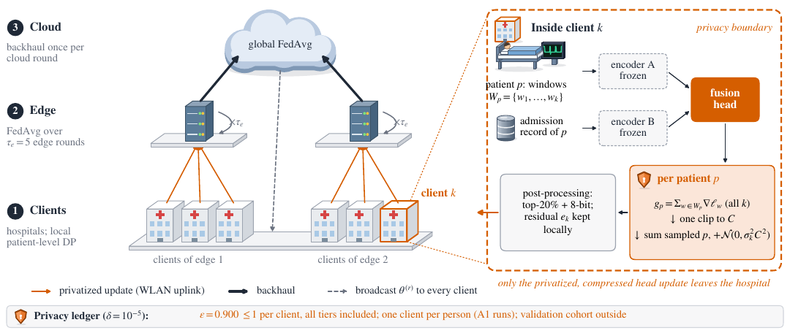

**Three tiers:**
| Tier | Role |
|------|------|
| **Clients** (hospitals, surgical specialties, wearable participants) | Hold patient records locally; encode with frozen encoders; train only the fusion head under patient-level DP; send a compressed update |
| **Edge aggregators** (E = 2 by default) | Average their clients' updates with public weights for τₑ = 5 edge rounds |
| **Cloud aggregator** | Averages the edges, broadcasts the global model (R = 10 cloud rounds) |

**One training round, four stages:**
1. **Local encoding** — each record passes through two frozen, pretrained encoders.
2. **Patient-level private training** — only the fusion head is trained; each patient's gradients
   are summed *before* clipping; noise is added.
3. **Per-client noise calibration** — each client sets its noise from its own patient count, so
   every patient gets the same budget.
4. **Hierarchical aggregation** — sparsified (top-20 %), 8-bit quantized update → edge → cloud.

### 6.1 The Model (Frozen Multimodal Backbone)

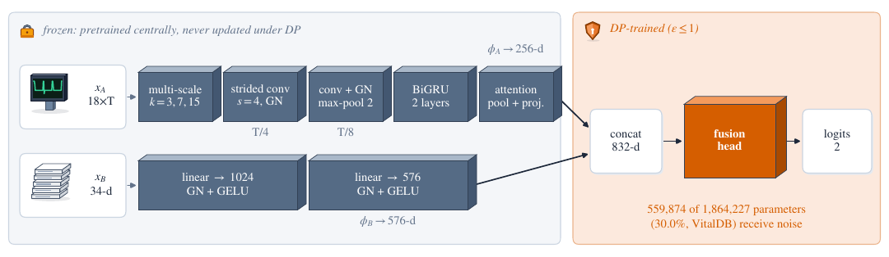

- **Temporal encoder (modality A, time series):** three parallel 1-D convolutions of different
  kernel widths → strided convolution → convolution + max pooling → 2-layer bidirectional
  recurrent layer → attention pooling.
- **Static encoder (modality B, feature vector):** 2-layer perceptron.
- **Fusion head:** concatenated embeddings → class logits. **559,874 of 1,864,227 parameters (30 %)**.
  Only this head is trained privately and transmitted.
- All normalization is group/layer norm, **never batch norm**: batch norm mixes statistics across
  patients, which would make the per-patient gradient ill-defined and break the accounting.
- **Two encoder configurations:**
  - *Disjoint:* encoders pretrained on a pool of people reserved before training and verified
    disjoint from every client → valid end to end.
  - *Oracle:* encoders pretrained on the pooled client training data → not valid end to end; used
    only to study the private head; its utilities are upper bounds.

---

## 7. The Core Mechanism: Patient-Level DP-SGD

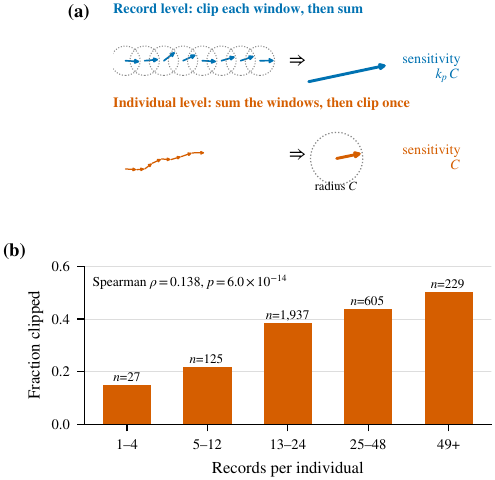

At each local step, client k:

1. **Samples patients** (Poisson): each patient is included with probability
   q_k = min(1, B / |P_k|), with B = 64 expected patients per step.
2. **Groups by patient:** sums the gradients of *all* records of each sampled patient p → g_p.
3. **Clips the sum:** ḡ_p = g_p · min(1, C / ‖g_p‖), with C = 1.
   → A patient changes the aggregate by at most C **no matter how many records they have**.
   (Clipping each record would allow k_p · C.)
4. **Adds noise once:** N(0, σ_k² C² I).
5. **Divides by the *expected* batch size** q_k·|P_k| — **not** the realized number of sampled
   patients |S|. The realized |S| depends on whether a given patient is present, so dividing by it
   would leak information. A step with an empty sample still releases noise.
6. Updates the head (Adam, which is post-processing of the released gradient).

A public rule caps a patient at 64 records per step for compute (truncates 4.1 % of eICU patients,
no VitalDB patient); because the rule is fixed and public, the guarantee is unaffected.

### 7.1 Per-Client Noise Calibration
- Hospitals differ hugely in size. A tiny hospital samples almost all of its patients every step
  and needs a lot of noise.
- One global noise level fitted to the smallest client would punish every larger client:
  on eICU, a hospital of 15 patients at q = 1 would set the noise for all 187.
- Because each patient is held by exactly one client (assumption A1), **parallel composition**
  applies: a patient's guarantee is that of their own client. So each client uses the *smallest*
  noise multiplier σ_k that meets ε for its own sampling rate and step count, computed with the
  **privacy loss distribution (PLD) accountant**.
- σ_k depends only on public declared sizes, so using a different σ per client releases nothing.
- Range on eICU: **4.85 to 29.34 (median 13.76)**; one worst-case multiplier would impose 29.34 on
  every hospital. VitalDB: 6.34 to 15.56.

### 7.2 Hierarchical Aggregation and Update Encoding
- Edge and cloud use **public, fixed weights** (declared sizes). Weights computed from the records
  drawn in a round would depend on which patients were sampled and would leak.
- Update encoding: keep top-20 % largest coordinates, quantize to 8 bits, keep the residual locally
  (error feedback). These act on already-noisy updates → **post-processing**, no extra privacy cost.

---

## 8. The Privacy Guarantee (Theorem 1)

**Three assumptions:**
- **A1** Each patient's records lie in the training split of exactly one client; training and
  validation cohorts are disjoint in patients.
- **A2** Architecture, encoder parameters (pretrained on a disjoint pool), hyperparameters, edge
  map, standardization constants and declared client sizes are public and fixed before training.
- **A3** The forward pass of a record depends on that record alone (hence no batch norm).

**Theorem 1 (Patient-level guarantee):** Under A1–A3, the full transcript of a run — every encoded
client update, every edge and cloud model, and the selected checkpoint — is (ε, δ)-DP with respect
to each training patient, under adding or removing *all* records of one patient.

**Proof idea in four steps (for the slide):**
1. *One step* — a Poisson-subsampled Gaussian mechanism with sensitivity C.
2. *Composition* — the T_k steps compose adaptively; σ_k is chosen so ε_k ≤ ε.
3. *Other clients* — by A1 they never touch patient p's records → no privacy loss for p.
4. *Hierarchy* — sparsification, quantization, averaging, broadcast and checkpoint selection are
   post-processing.

**Corollary (Coincidence of the units):** If every patient has exactly one record, the patient-level
mechanism *is* record-level DP-SGD. So any difference at k = 1 measures noise between seeds, not
the privacy unit. → This is used as a **built-in positive control** in the k-scaling experiment.

### 8.1 Privacy Ledger (what is released and who is protected)
| Release | Population | Protection |
|---------|-----------|-----------|
| Client updates, edge/cloud models | training | (0.9, 10⁻⁵)-DP per client |
| Selected checkpoint | validation | none (conventional) |
| Conformal threshold (evaluated only) | validation | ε_conf = 0.1 |
| Standardization (headline runs) | training | none |
| Standardization (eICU rerun) | public pool | public |
| Declared sizes, q_k, T_k, σ_k | — | public by design |
| Encoders (disjoint pool) | external | not required |
| Encoders (oracle) | training | violates A2 |

**Only one configuration is private end to end:** eICU with disjoint encoders and standardization
constants fitted on the disjoint pool, on the partition where each person is at one hospital.
Be clear about this when presenting — it is a strength of the paper that it is stated precisely.

### 8.2 Scope caveats (know them, mention briefly)
- **eICU source partition:** 2.9 % of training persons (2,177 of 74,327) appear at 2–4 hospitals,
  so A1 fails for them; their per-hospital budgets compose to ε ≤ 1.32 / 1.64 / 1.92. The headline
  privacy-cost runs therefore use a rebuilt partition with each person moved to one hospital.
- **VitalDB case-level partition** (used in earlier experiments) protects the surgical *case*, not
  the person; 3.9 % of people had more than one operation. The person-level partition was rebuilt
  and the key results (privacy cost, cost of unit, baselines, audit) re-run on it.
- **WEAR:** each client is one participant, so the guarantee there is record-level.
- **Independent accounting check:** every client of every run recomputed: PLD gives ε in
  [0.880, 0.900]; the looser Rényi accountant gives 0.974. Both are below 1.

---

## 9. The Scaling Hypothesis A(1 − 1/k)

**Proposition (intuition):** with P individuals each contributing k records, under convex,
Lipschitz assumptions,
- record-level private training has P·k units → excess risk ∝ 1/(P·k),
- patient-level private training has only P units → excess risk ∝ 1/P.
- If both attain their rates with a common constant, the gap is **A(1 − 1/k)** with A = cΛ/P.

**What it predicts (shape, not magnitude):**
- zero gap at k = 1,
- the gap grows with k and saturates,
- the patient-level model's accuracy does **not** depend on k.

**Be honest:** the form is a **scaling hypothesis** motivated by the proposition, not a theorem; it
was tested empirically, including out of sample.

---

## 10. Datasets

All three are public corpora in which both modalities come from the **same individual** and are
**paired at the source** (not by an artificial matching rule — a fusion claim requires this).

| | VitalDB | WEAR | eICU |
|---|---|---|---|
| Domain | Surgery (intraoperative) | Wearable activity (non-clinical) | Intensive care |
| Clients | 9 surgical specialties | 22 participants | 187 hospitals |
| Individuals | 5,974 | 22 | 132,736 |
| Mean records per individual k̄ | 7.9 | ≈ 1,750 | 28.5 |
| Modality A | 18-ch. trends (9 vitals + 9 missingness flags), 10 min at 0.5 Hz | 12-ch. inertial | 12-ch. vitals (6 + 6 indicators), first 24 h |
| Modality B | 34 preoperative clinical/lab variables | 2048-dim video features | 5 admission variables (age, sex, weight, height, APACHE) |
| Task | Postoperative ICU admission | 18 activities | In-unit mortality |
| Prevalence | 18.84 % | — | 4.22 % |

**Leakage controls (worth a slide line):**
- Split by person/case, never by window (windows are near-duplicates).
- Modality B restricted to **pre**-operative variables (intraoperative interventions encode the outcome).
- Missing values filled within a case with an explicit indicator (e.g., an arterial line is placed only
  in at-risk patients).
- Normalization statistics from training cases only (or the disjoint pool for end-to-end eICU).
- VitalDB clients differ ~8× in size and >15× in outcome prevalence (3.0–50.4 %) — natural
  heterogeneity, not an imposed skew.

---

## 11. Experimental Setup (Key Parameters)

| Parameter | Value |
|-----------|-------|
| Cloud rounds R; edge rounds τₑ | 10; 5 |
| Edge aggregators E | 2 (eICU scaling test: 2–16) |
| Optimizer; learning rate | Adam; 10⁻³ (weight decay 10⁻⁴) |
| Expected individuals per step B | 64 |
| Clipping norm C | 1 |
| Training budget | ε = 0.9, δ = 10⁻⁵ |
| Accountant | PLD, per-client σ_k |
| Update encoding | top-20 %, 8-bit, error feedback |
| Seeds | 5 paired (3 for grids) |
| LiRA shadow models | 16 |
| Software | PyTorch 2.5, Opacus 1.5, ONNX Runtime, ns-3 3.46, CloudSim Plus 8.5 |
| Hardware | one NVIDIA RTX A2000 GPU; latency on Intel Core i7-14700 CPU |

**Metrics:** AUROC (primary), AUPRC (imbalanced tasks), balanced accuracy at a Youden threshold
chosen on validation. Plain accuracy is *not* used: under imbalance a constant prediction gets the
base rate.

**Statistics:** comparisons are **paired by seed**; 95 % Student-t intervals. An effect is
**resolved** only when the interval excludes zero. Seed counts were fixed before each comparison.

**Measurement tools (one tool per objective, no number reported twice):**
- Uplink — measured payload of the actual encoding (including the sparse index array).
- Delivery and round latency — packet-level **ns-3** simulation, every round.
- Energy — **CloudSim Plus** model, per tier.
- Inference latency — **ONNX Runtime**, P95 over 1,000 runs after 100 warm-ups.

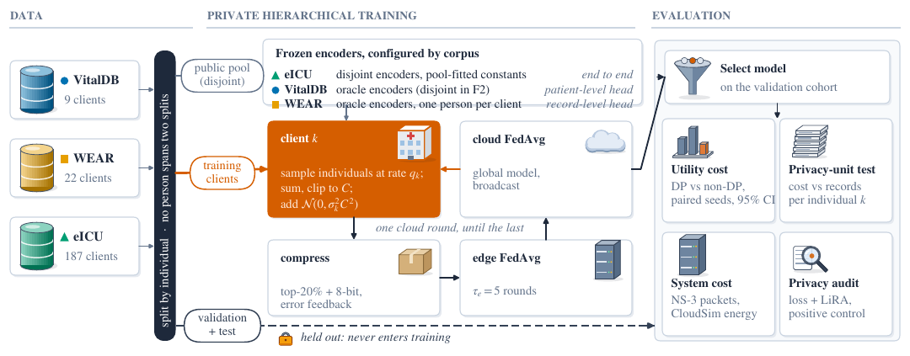

---

## 12. Results

### 12.1 System Objectives (RQ4 – system)

| | Quantity | VitalDB | WEAR | eICU | Target |
|---|---|---|---|---|---|
| O1 | Uplink reduction | **90.8 %** | **96.1 %** | **92.3 %** | ≥ 50 % |
| O1b | Round latency cut | 16.9 % | 21.7 % | 33.4 % | > 0 % |
| O2a | Budget ε | 0.900 | 0.766 (record) | 0.900 | ≤ 1 |
| O2b | Utility loss [pts] | **−1.18** | 1.97 pp (incon.) | 3.10 (incon.) | ≤ 2 |
| O3a | P95 latency [ms] | 2.30 | 0.75 | 0.24 | < 100 |
| O3b | Update delivery | 100.00 % | 99.94 % | 97.83 % (**not met**) | > 99 % |
| O4 | Energy saving | **72.3 %** | **76.8 %** | **79.6 %** | ≥ 20 % |

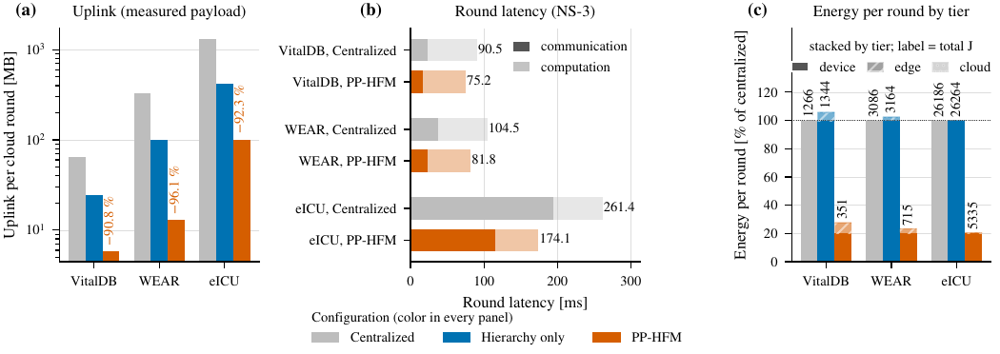

**Explain:**
- **Uplink:** two-tier aggregation of a compressed head update → 90.8–96.1 % less traffic.
  The measurement includes the sparse index array that analytical estimates usually omit.
- **Round latency:** VitalDB 90.5 → 75.2 ms; WEAR 104.5 → 81.8 ms; eICU 261.4 → 174.1 ms.
  Smaller than the traffic saving because the hierarchy shortens link time, not computation.
- **Inference:** ≤ 2.3 ms P95 against a 100 ms budget. DP adds nothing at inference (noise is only
  in training). 8-bit quantized inference was *rejected* — it raised P95 to 17.34 ms.
- **Delivery on eICU:** 187 clients on 2 edges contend for the shared wireless medium → 97.83 %
  (centralized: 95.11 %). With more edges, delivery rises monotonically: target met on average from
  6 edges and in every round from **8 edges** (~23 clients/edge), 99.94 % at 16.
- **Energy:** adding the edge tier alone *increases* energy (1,266 → 1,344 J on VitalDB); the saving
  comes from PP-HFM cutting device computation and transmission ~5×.

### 12.2 Privacy Budget and Utility (RQ1)

**Finding:** every training patient is protected across all tiers at ε = 0.900, δ = 10⁻⁵.

| Corpus | Non-private AUROC | Private AUROC | Cost (points, 95 % CI) | Verdict |
|---|---|---|---|---|
| VitalDB (person-level) | 0.8200 | **0.8318** | **−1.18** [−1.63, −0.73], p = 0.002 | Met — private is *better* |
| eICU, training transcript | 0.8239 | 0.7929 | 3.10 [1.55, 4.65] | Inconclusive (interval spans 2) |
| eICU, end to end | — | — | 3.88 [2.60, 5.17] | Missed |
| WEAR (record-level) | — | — | 1.97 pp [1.76, 2.17] accuracy | Inconclusive |

- **Why is VitalDB private better?** Consistent with clipping + noise **regularizing** the compact
  head (the ablation shows non-private seeds peak early and then degrade). The experiment does not
  isolate this, so say "consistent with".
- **Why does eICU cost more?** The cost is set by the **smallest hospitals**, which sample every
  patient at every step and carry the largest noise multipliers.
- **Cost of the unit (record → patient), VitalDB person-level, ε = 1:** AUROC −0.0170
  (0.8423 → 0.8254); AUPRC −0.0582. Two effects: fewer sampled units (33,491 records → 4,221
  patients) and clipping of summed gradients.
- **Cost of disjoint encoders (VitalDB case-level):** −1.57 ± 0.46 AUROC points vs. oracle; with
  matching non-private disjoint reference, the privacy cost is +0.14 [−0.33, +0.62] → O2b met.
- **Diagnostic negative result:** a privately released conformal threshold (ε_conf = 0.1) with
  ~100 calibration patients per client collapsed to the majority-class set — coverage = base rate.
  It was **evaluated and removed** from the system.

### 12.3 Initialization, Not the Privatized Subset (RQ3)

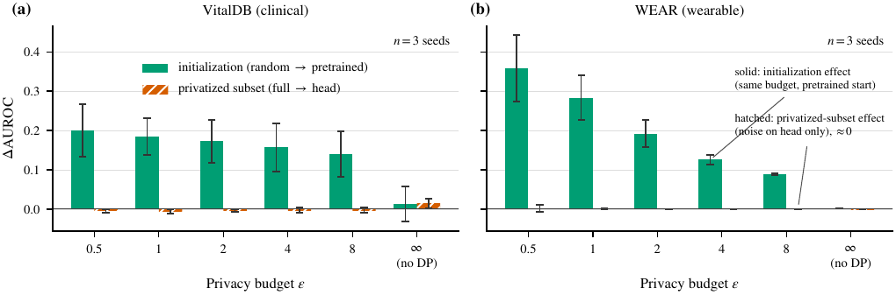

Three models at ε ∈ {0.5, 1, 2, 4, 8, ∞}:
- **B4** full model, private, random init (prior art)
- **B7** full model, private, pretrained init
- **B6** head only, private, pretrained init (PP-HFM)

| ε | VitalDB init effect (B4→B7) | VitalDB subset effect (B7→B6) | WEAR init | WEAR subset |
|---|---|---|---|---|
| ∞ | +0.0129 | +0.0139 ± 0.0124 | +0.0021 | −0.0002 |
| 8 | +0.1407 | −0.0025 ± 0.0059 | +0.0883 | +0.0001 |
| 1 | +0.1841 | −0.0059 ± 0.0063 | +0.2827 | +0.0003 |
| 0.5 | **+0.1991** | −0.0042 ± 0.0043 | **+0.3580** | +0.0013 |

**Message:** the initialization effect grows monotonically as the budget tightens (up to +0.199
AUROC on VitalDB, +0.358 on WEAR); the subset effect is indistinguishable from zero at every finite
budget. A random-init private model loses 0.19 AUROC (WEAR: falls to 0.62, near chance); a
pretrained one loses 0.004. **Training only the head is justified by communication, not accuracy.**
Practical rule: *secure a legitimate pretrained initialization first.*

### 12.4 Records per Individual — the k-Law (RQ2)

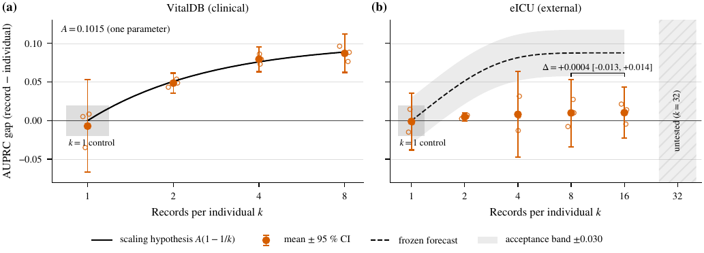

Design: vary k (records kept per individual) with the **units per step held equal** in both arms,
so only the clipping geometry differs. k = 1 is the built-in control (Corollary).

| k | VitalDB gap (AUPRC) | p | eICU gap | eICU forecast |
|---|---|---|---|---|
| 1 | −0.0071 ± 0.0599 | 0.661 | −0.0011 | 0.0000 |
| 2 | **+0.0486** ± 0.0129 | 0.004 | +0.0048 | 0.0515 |
| 4 | **+0.0796** ± 0.0163 | 0.002 | +0.0081 | 0.0816 |
| 8 | **+0.0872** ± 0.0248 | 0.004 | +0.0099 | 0.0876 |
| 16 | — | — | +0.0103 | 0.0878 |

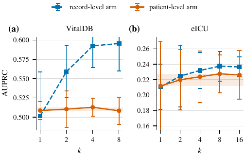

**VitalDB:**
- At k = 1 the units are indistinguishable → the control passes; later divergence is due to the unit.
- Patient-level model stays **flat** (AUPRC 0.508–0.513); record-level rises (0.502 → 0.596).
- One-parameter fit A(1 − 1/k): **A = 0.1015**, RMSE 0.0119 — a two-parameter curve gives 0.0117,
  so the extra parameter buys nothing. Fitted on k ≤ 4 only, it predicts 0.0904 at k = 8 vs 0.0872
  observed (**out-of-sample**).

**External test on eICU (pre-registered forecast):**
- The forecast was registered **before the eICU corpus was built**.
- k = 1 control holds; the **shape and saturation reproduce**; the **magnitude does not**
  (≈ 1/9 of forecast); no eICU gap is resolved at 3 seeds (~25 seeds would be needed).
- Plausible reasons: attainable precision is lower on eICU (AUPRC ≈ 0.22 at 4.2 % prevalence vs.
  ≈ 0.5); differences in client sizes, k, and features. Not isolated → needs a third corpus.
- Max k reduced from 32 to 16 by a **dated amendment before** results beyond k = 8 were computed
  (only 20.2 % of eICU individuals reach 32 records).

**Checks against alternative explanations:**
- *Budget confound:* re-running VitalDB at the eICU operating point does not shrink the gap
  (+0.0914 at k = 8) → budget does not explain the shortfall (that grid fails its own k = 1 control;
  disclosed).
- *Clipping rule:* normalizing each patient's summed gradient by record count does not recover the
  cost on eICU (−0.0012; upper bound +0.0043 excludes the pre-set +0.010); on VitalDB it explains at
  most 1/8 → **the cost belongs mainly to the unit**, not to the clipping rule.

**Interpretation:** a patient-level guarantee becomes relatively *more* expensive as more records
are collected per patient. What would recover it: clipping around an estimate of each individual's
mean gradient (user-level rates that improve with k) — future work.

### 12.5 Multimodal Fusion

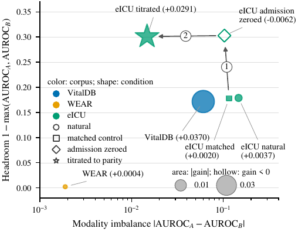

- **VitalDB:** fused 0.8653 vs. best single modality 0.8283 → **+0.0370 AUROC** (5.9 seed SDs),
  +0.0671 AUPRC.
- **WEAR:** best single modality already 0.9976 — no headroom.
- **eICU natural:** no gain (+0.0037): admission stream (0.8221) dominates vitals (0.7068).
- **Pre-specified test:** weaken the strong stream to parity with variance-preserving noise →
  fused exceeds best single by **+0.0291**, positive on all 5 seeds (p = 0.019), 14× the control.
  **Balance is sufficient for a fusion gain, not shown to be necessary.**

| Condition | Vitals | Admission | Fused | Gain |
|---|---|---|---|---|
| Matched control | 0.7068 | 0.8221 | 0.8241 | +0.0020 |
| Feature zeroed | 0.6973 | 0.5947 | 0.6911 | −0.0062 |
| Titrated to parity | 0.6992 | 0.6845 | 0.7282 | **+0.0291** |

### 12.6 Component Ablation (VitalDB, case-level, record-level mechanism, 3 seeds)

| Removed | AUROC | ΔAUROC | Uplink MB |
|---|---|---|---|
| — (full) | 0.8541 | — | 252 |
| C1 hierarchy | 0.8484 | −0.0058 ± 0.0088 | 50 |
| C2 privacy | 0.8307 | **−0.0234 ± 0.0205** | 252 |
| C3 sparsification | 0.8553 | +0.0012 | 1260 |
| C4 quantization | 0.8543 | +0.0001 | 403 |
| +C6 loss weighting | 0.8542 | +0.0001 | 252 |

- Compression costs no accuracy and saves 5× (sparsification) and 1.6× (quantization) traffic.
- Removing the hierarchy: resolved at 6 seeds as a small cost (−0.0047 VitalDB, −0.0052 WEAR) —
  i.e. the hierarchy does not hurt accuracy.
- Removing privacy *reduces* AUROC: non-private seeds peak at round 1 and degrade; private seeds
  peak at rounds 6–9 → regularization.

### 12.7 Membership-Inference Audit (RQ4 – audit)

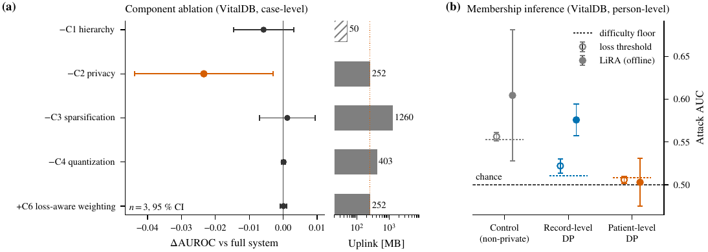

**Why an audit?** A proof bounds what an adversary *can* learn; an audit measures what a concrete
attack *does* achieve.

**Design:**
- Members = training patients; non-members = held-out patients.
- Attacks: **loss threshold** and **LiRA** (likelihood-ratio attack) adapted to the patient unit,
  with 16 shadow models trained on random halves of the patient population.
- **Positive control:** non-private training of the same head — proves the attack *can* detect
  leakage. A negative result is accepted only if the control is detected.
- **Difficulty floor:** AUC from per-patient difficulty alone, without the target model.

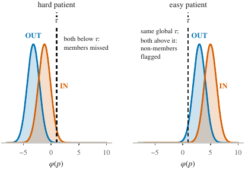

| Configuration | Loss AUC | LiRA AUC | Floor | Margin |
|---|---|---|---|---|
| Control (no DP) | 0.556 | 0.605 | 0.553 | +0.052 |
| Record-level DP | 0.522 | **0.576** | 0.511 | **+0.065** |
| Patient-level DP | 0.506 | **0.503** | 0.508 | **−0.005** |

- Record-level training leaks detectably above its floor; **patient-level training sits at its floor**.
- Paired over 5 seeds: record-level exceeds patient-level by +0.073 [0.054, 0.092] (p < 0.001) for
  offline LiRA — survives correction for four attacks.
- Honest: the effect is **smaller than predicted** (0.576, not 0.7). The audit covers VitalDB only
  and bounds these attacks; it does not prove absence of leakage.

### 12.8 Comparison with Prior Systems (HED-FL, FL2DP)

Re-implemented under identical data, encoders, rounds and seeds.

| | System | ε | AUROC | Uplink MB | LiRA (margin) |
|---|---|---|---|---|---|
| VitalDB | **PP-HFM** | 0.90 | **0.8318** | **252** | **0.503 (−0.005)** |
| | HED-FL | ∞ | 0.8262 | 560 | 0.581 (+0.026) |
| | FL2DP | — | 0.8195 | 1008 | 0.608 (+0.049) |
| eICU | PP-HFM | 0.90 | 0.7936 | **5235** | — |
| | HED-FL | ∞ | **0.8252** | 12541 | — |

- PP-HFM uploads **2.2–4.0× less** and leaks less on VitalDB.
- On eICU, non-private HED-FL is 3.17 points more accurate — but it is level with PP-HFM's own
  non-private reference, so the gap **is the price of the patient-level guarantee**.
- **FL2DP leaks more than HED-FL**, which adds no noise at all: its candidate set is built from the
  private gradient value, so it satisfies no finite ε — "a perturbation without a finite ε is not
  a weaker guarantee but no guarantee."

---

## 13. Answers to the Research Questions

| RQ | Answer |
|----|--------|
| RQ1 | **Yes.** Enforced and accounted across all tiers at ε = 0.9 (proof + ledger + independent recomputation). Costs nothing on VitalDB (−1.18 pts), 3.1 pts on eICU (3.9 end to end), driven by the smallest hospitals. |
| RQ2 | The cost follows **A(1 − 1/k)**: zero at k = 1, grows and saturates. Shape transfers to eICU; magnitude is corpus-dependent. |
| RQ3 | **Pretrained initialization** (up to +0.199 AUROC at ε = 0.5), not the smaller privatized subset (≈ 0). |
| RQ4 | Uplink, latency and energy targets met on all three corpora; eICU delivery needs ≥ 8 edges. Less traffic and less measured leakage than HED-FL and FL2DP; audit separates the units. |

---

## 14. Practical Implications (Four Recommendations)

1. **Choose the unit explicitly** and price it in records per individual — a record-level budget
   bounds the wrong quantity when individuals contribute many records.
2. **Secure a legitimate pretrained initialization** before tuning anything else.
3. **Calibrate each client to its own population** and consider a minimum cohort size, since the
   smallest hospitals set the cost (29.34 worst-case vs. 13.76 median multiplier on eICU).
4. **Use compression and the edge tier** — they cut traffic and energy at no measurable accuracy
   cost; establish fusion per task.

---

## 15. Limitations (State Them Confidently)

- **Utility:** eICU cost inconclusive vs. the 2-point target, missed end to end; WEAR inconclusive.
- **Encoders and unit:** VitalDB/WEAR use oracle encoders unless stated (upper bounds); several
  VitalDB analyses are case-level; WEAR is record-level; eICU source partition qualified.
- **Power:** grids and recipe use 3 seeds; resolving eICU k-gaps needs ~25 seeds. Audit: 16
  shadows, VitalDB only.
- **Baselines and simulation:** HED-FL and FL2DP re-implemented; network simulated (ns-3), energy
  modeled (CloudSim Plus), latency on workstation CPU, not edge hardware.
- **Theory:** A(1 − 1/k) supported empirically, not proved.

---

## 16. Future Work

- Test a **third corpus** to separate corpus effects from the k-law magnitude.
- **Sample patients across the clients of an edge.**
- **Clip around each individual's mean gradient** to recover the cost of the unit.
- **Extend the membership-inference audit to eICU** (~160 GPU hours).
- Confirm network and energy figures on **physical edge hardware**.

---

## 17. Research Integrity (Good Material for "How was this done?")

Many errors produced plausible numbers without crashing. All were found, fixed and the affected
results re-run; old results are archived, not overwritten. Examples:
- Noise calibrated from one client → every DP arm exceeded its budget. Fixed.
- Conformal calibration fired 5× → total ε was 3.49, not 0.96. Fixed, later removed.
- ns-3 had never actually run → early "network results" were analytical fallbacks. Built ns-3;
  now packet-level every round.
- **Dividing by realized |S|** (found while writing the proof, 22 Oct) → not the analyzed
  mechanism; fixed to the expected batch; all patient-level results re-run.
- VitalDB split by surgical case → 55 of 940 test persons also had a training case. Rebuilt by
  person and re-ran the key results.
- eICU multi-hospital persons (2.9 %) found by an accounting audit → disclosed, and a
  one-hospital-per-person partition built for the headline.
- Forecasts and acceptance criteria were **fixed before** the runs (k-law, fusion test, clipping
  rule test, seed counts).

---

## 18. Conclusion (Closing Statement)

Protecting **patients** rather than **records** is feasible in a client–edge–cloud medical IoT
deployment. PP-HFM proves and accounts for the guarantee across every tier, keeps the system
efficient (90.8–96.1 % less uplink, 72.3–79.6 % less energy, ≤ 2.3 ms inference), costs nothing on
VitalDB and about 3 AUROC points on eICU, and its cost depends mainly on **the number of records per
patient** and **the size of the smallest clients**.
